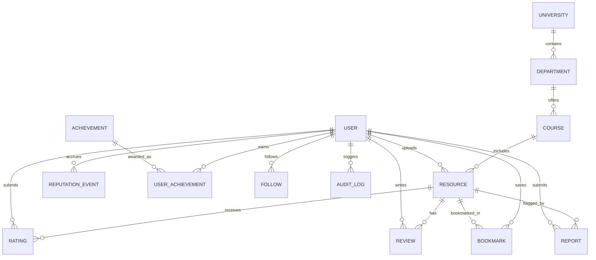

# SOFTWARE REQUIREMENTS SPECIFICATION (SRS)
## Peer's Charity — Full-Stack Academic Resource Sharing Platform

---

### Document Control
- **Document Version:** 1.0.0
- **Standard:** IEEE Std 830-1998 / ISO/IEC/IEEE 29148:2018 Compliant
- **Status:** Approved / Engineering Baseline
- **Primary Authors:** Peer's Charity Core Engineering Team
- **Canonical Document:** [docs/SRS.md](file:///D:/Code/peers-charity/docs/SRS.md)
- **Project Repository:** `https://github.com/asnayem1122/Peers_Charity.git`

---

## Table of Contents
1. [Introduction](#1-introduction)
   - 1.1 Purpose
   - 1.2 Document Conventions & Terminology
   - 1.3 Intended Audience & Reading Suggestions
   - 1.4 Project Scope
   - 1.5 References
2. [Overall Description](#2-overall-description)
   - 2.1 Product Perspective & System Context
   - 2.2 Product Functions (High-Level Functional Decomposition)
   - 2.3 User Classes & Personas
   - 2.4 Operating Environment & Technical Ecosystem
   - 2.5 Design & Implementation Constraints
   - 2.6 User Documentation & Guides
   - 2.7 Assumptions & Dependencies
3. [External Interface Requirements](#3-external-interface-requirements)
   - 3.1 User Interfaces (UI/UX)
   - 3.2 Hardware Interfaces
   - 3.3 Software & Service Interfaces
   - 3.4 Communications & Protocol Interfaces
4. [System Features & Functional Requirements](#4-system-features--functional-requirements)
   - 4.1 Module 01: Authentication, Verification & Identity Governance (FR-AUTH)
   - 4.2 Module 02: 3-Tier Academic Taxonomy & Resource Metadata (FR-TAX)
   - 4.3 Module 03: Document Ingestion, Deduplication & Storage Pipeline (FR-UPL)
   - 4.4 Module 04: Public Discovery, Search & Filtering (FR-DISC)
   - 4.5 Module 05: Academic Pantry & Course Coverage Health (FR-PANTRY)
   - 4.6 Module 06: Exam Emergency Room & High-Yield Revisions (FR-EXAM)
   - 4.7 Module 07: Resource Quality Score (RQS) & Rating Algorithm (FR-RQS)
   - 4.8 Module 08: Reputation Engine, Gamification & Generosity Olympics (FR-REP)
   - 4.9 Module 09: Personal Library (My Treasure) & Social Following (FR-SOC)
   - 4.10 Module 10: Content Moderation, Reporting & Administrative Vault (FR-MOD)
   - 4.11 Module 11: Telemetry, Analytics & System Accounting (FR-ANL)
5. [Non-Functional Requirements (NFRs)](#5-non-functional-requirements-nfrs)
   - 5.1 Performance & Scalability (NFR-PERF)
   - 5.2 Security & Vulnerability Defense (NFR-SEC)
   - 5.3 Reliability, Availability & Fault Tolerance (NFR-REL)
   - 5.4 Maintainability & Extensibility (NFR-MAINT)
   - 5.5 Usability & Accessibility (NFR-UX)
6. [Data Requirements & Schema Architecture](#6-data-requirements--schema-architecture)
   - 6.1 Entity-Relationship Conceptual Model
   - 6.2 Data Dictionaries & Model Specifications
   - 6.3 Database Indexing Strategy
7. [Verification & Traceability Matrix](#7-verification--traceability-matrix)
   - 7.1 Test Suites & Validation Strategy
   - 7.2 Requirements Traceability Matrix (RTM)
8. [Appendix & Glossary](#8-appendix--glossary)
   - 8.1 Product Domain Terminology
   - 8.2 Acronyms & Abbreviations

---

## 1. Introduction

### 1.1 Purpose
This Software Requirements Specification (SRS) establishes a complete, unambiguous, and verifiable specification for **Peer's Charity**, a modern, full-stack, non-monetary academic resource-sharing platform. This document delineates the functional and non-functional requirements, architectural standards, data models, external interfaces, and security controls governing both backend API development (`apps/api`), frontend presentation (`apps/web`), and shared contract schemas (`packages/shared`).

### 1.2 Document Conventions & Terminology
- **Requirement Identifiers:** 
  - `FR-<MODULE>-<NUMBER>`: Functional Requirement (e.g., `FR-AUTH-01`).
  - `NFR-<CATEGORY>-<NUMBER>`: Non-Functional Requirement (e.g., `NFR-SEC-03`).
- **Priority Keywords (RFC 2119):**
  - **SHALL / MUST:** Absolute mandatory requirement.
  - **SHOULD / RECOMMENDED:** High priority, valid engineering reasons needed to deviate.
  - **MAY / OPTIONAL:** Permissible feature for subsequent release cycles.

### 1.3 Intended Audience & Reading Suggestions
- **Software Engineers & Architects:** Review Sections 2, 4, 5, and 6 for technical implementation, data contracts, and algorithmic constraints.
- **QA & Security Engineers:** Focus on Section 5.2 (VAPT & Security Hardening), Section 4 validation rules, and Section 7 (Traceability Matrix).
- **Product Owners & Academic Stakeholders:** Review Sections 1.4, 2.2, 2.3, and 8.1 for functional terminology and scope boundaries.

### 1.4 Project Scope
**Peer's Charity** solves the systemic fragmentation and commercialization of student-produced academic materials. Rather than monetizing university study aids or locking notes behind paid paywalls, Peer's Charity provides a cooperative, reputation-driven digital commons where students upload, discover, rate, and curate:
- Past exam papers (Class Tests, Mid-Terms, Finals).
- Lecture hand-notes, lecture slide decks, and verified educational external references.
- Sessional laboratory reports, hardware/software lab manuals, and sample assignment code.

The system enforces cryptographic file deduplication (SHA-256), a multi-parameter Resource Quality Score (RQS), strict academic hierarchical taxonomy, Level/Term access segmentation, and anonymous or pseudonymous contribution options with zero moderation bypass.

### 1.5 References
- [IEEE Std 830-1998]: IEEE Recommended Practice for Software Requirements Specifications.
- [ISO/IEC/IEEE 29148:2018]: Systems and software engineering — Life cycle processes — Requirements engineering.
- [OWASP ASVS 5.0]: Application Security Verification Standard (Web Security).
- [RFC 7807]: Problem Details for HTTP APIs (Standardized Error Response Semantics).
- Repository Documentation: `docs/PROJECT_SPEC.md`, `docs/ARCHITECTURE.md`, `docs/DATABASE.md`, `docs/SECURITY.md`, `docs/API.md`.

---

## 2. Overall Description

### 2.1 Product Perspective & System Context
Peer's Charity operates as a distributed web platform leveraging a modern monorepo layout:
- `apps/web`: Next.js 14 App Router (React 18, Tailwind CSS, Lucide Icons, Framer Motion) providing public discovery, dynamic search catalogs, and responsive user interfaces.
- `apps/api`: Node.js + Express 4 + TypeScript REST service managing authentication sessions, business logic, file stream processing, and MongoDB Atlas persistence.
- `packages/shared`: Shared TypeScript package maintaining canonical Zod validation schemas, domain types, and system-wide constant dictionaries.

```
                              [ UNIVERSITY BENEFACTORS & STUDENTS ]
                                                |
                                                | HTTPS (Browser / Mobile)
                                                v
               +-----------------------------------------------------------------+
               |                    Next.js 14 Web Frontend                     |
               |                (apps/web — Port 3000 / Vercel Edge)             |
               +--------------------------------+--------------------------------+
                                                |
                                                | RESTful JSON API / CORS / Cookies
                                                v
               +-----------------------------------------------------------------+
               |                   Express 4 Backend API Engine                  |
               |                     (apps/api — Port 5000)                      |
               +--------+-----------------------+-----------------------+--------+
                        |                       |                       |
                        v                       v                       v
               +-----------------+     +-----------------+     +-----------------+
               |  MongoDB Atlas  |     | Object Storage  |     |   Better Auth   |
               | (Database 7.0+) |     | (S3 / R2 / Dev) |     | (Auth Handler)  |
               +-----------------+     +-----------------+     +-----------------+
```

### 2.2 Product Functions (High-Level Functional Decomposition)
1. **Identity & Access Management:** Domain-validated registration (`@*.edu`), role-based authorization (`STUDENT`, `TEACHER`, `MODERATOR`, `ADMIN`, `SUPER_ADMIN`), and privacy identity selection (Real Profile, Anonymous, Pseudonym).
2. **Resource Ingestion & Verification:** 4-step donation wizard, client and server MIME/magic number validation, cryptographic SHA-256 duplicate rejection, and secure object storage persistence.
3. **Structured Discovery & Navigation:** Categorized browsing across 3-tier academic taxonomy (`question`, `course_material`, `sessional`) with instant filter bars and multi-axis sorting.
4. **Exam Emergency Room (EER):** High-yield exam revision hub filtering questions and solutions by course and examination phase (`CT`, `MID`, `FINAL`).
5. **Academic Pantry Health:** Algorithmic calculation of syllabus and topic coverage percentages per academic course.
6. **Reputation & Gamification:** Non-monetary Charity Points, trust badges, contributor level tags, and dynamic Generosity Olympics rankings.
7. **Quality Scoring Engine:** Dynamic calculation of Resource Quality Score (0–100) using Bayesian rating smoothing, download volume, review sentiment, and age decay.
8. **Moderation & Security Guardrails:** Role-guarded administrative dashboard (`/admin`), donation vault queue, report dispute resolution, and security defenses.

### 2.3 User Classes & Personas
| User Class | Description & Access Rights |
|---|---|
| **Unauthenticated Guest** | Can browse public landing, search Charity Bazaar, preview public metadata, view course catalogs, and inspect leaderboards. Cannot download, bookmark, rate, or donate. |
| **Student Benefactor** | Authenticated university student (`@*.edu`). Can donate resources, download materials, rate/review peers, manage bookmarks (My Treasure), follow scholars, and earn Charity Points. |
| **Teacher / Faculty** | Verified academic instructor. Can contribute authoritative course slides/handouts, verify student-submitted past papers, and receive elevated badge status. |
| **Moderator (Charity Police)**| Trusted community moderator. Can review flagged resources (`SUSPICIOUS DONATIONS`), inspect duplicate alerts, and approve or hide pending materials in the Donation Vault. |
| **Administrator (HQ Staff)** | Full operational administrative privileges. Can inspect telemetry/analytics, moderate users, assign roles, modify taxonomy courses, and review immutable audit logs. |
| **Super Admin** | System owner. Possesses root privileges including platform configuration, database administration, and security rule management. |

### 2.4 Operating Environment & Technical Ecosystem
- **Client Runtime:** Modern web browsers (Chromium 120+, Firefox 120+, Safari 17+, Edge). Responsive layouts supporting mobile ($360\text{px}+$), tablet, and desktop ($1920\text{px}$).
- **Server Runtime:** Node.js LTS v20.x or v22.x on Linux / Windows / macOS.
- **Database Engine:** MongoDB 7.0+ (Replica Set / MongoDB Atlas).
- **Storage Layer:** AWS S3, Cloudflare R2, or local storage abstraction in development.
- **Deployment Targets:** Vercel Serverless / Edge for Next.js web application; Node.js VPS / Docker container / Vercel Serverless functions for Express API.

### 2.5 Design & Implementation Constraints
- **Strict Monorepo Dependency Isolation:** Frontend must not import backend-specific server modules (e.g. Mongoose models). Shared logic must strictly reside in `packages/shared`.
- **Pure JavaScript/TypeScript Ecosystem:** All components, APIs, and shared validation schemas must execute natively in Node.js and browser JS engines without binary native dependencies.
- **Non-Monetary Constraint:** The system SHALL NOT incorporate payment gateways, micro-transactions, or currency exchange mechanisms.

### 2.6 User Documentation & Guides
The system provides:
- Live Interactive FAQ & Guide on `/hq`.
- API specification and contract documentation in `docs/API.md`.
- Architecture and deployment runbooks in `docs/ARCHITECTURE.md` and `docs/DEPLOYMENT.md`.

### 2.7 Assumptions & Dependencies
- Students possess valid institutional email credentials or institutional identity proof for verification.
- Storage service provides minimum $99.9\%$ SLA availability for public object downloads.

---

## 3. External Interface Requirements

### 3.1 User Interfaces (UI/UX)
- **Design Paradigm:** High-contrast, clean SaaS UI inspired by modern engineering dashboards, utilizing deep obsidian dark themes and clean daylight light themes.
- **Component Palette:**
  - **Constellation Grid:** Dynamic canvas background responding to cursor coordinates with dark/light mode particle detection.
  - **Liquid Metal Buttons:** Obsidian surface styled with dynamic conic rim gradients, specular top highlights, and kinetic sheen on hover.
  - **Filter Bars (`ResourceFilterBar`):** Segmented pill navigation dynamically rendering sub-filters based on active academic section.
  - **Donate Wizard (`DonateModal`):** 4-step sequential modal: Step 1 (Academic Section & Course), Step 2 (Section-specific Metadata), Step 3 (File Upload / Link), Step 4 (Identity & Confirm).
  - **Universal Resource Detail Modal (`resource-detail-modal`):** Fullscreen responsive overlay displaying metadata, inline document preview, ratings, and peer reviews.

### 3.2 Hardware Interfaces
- No proprietary hardware interfaces required. Standard touch, trackpad, and keyboard input across desktop and mobile devices.

### 3.3 Software & Service Interfaces
- **Better Auth:** Handles credential hashing, session cookie issuance, email verification tokens, and social auth adapters.
- **MongoDB Atlas:** Connects via Mongoose ODM over TLS/SSL with connection pooling.
- **S3-Compatible Object Store:** Standard AWS S3 SDK (`@aws-sdk/client-s3`) supporting Cloudflare R2 and AWS S3 buckets.

### 3.4 Communications & Protocol Interfaces
- **HTTP/1.1 and HTTP/2 over TLS 1.3:** Enforced on all production public traffic.
- **CORS Policy:** Strict origin whitelisting (`FRONTEND_URL`); credentials mode enabled (`credentials: 'include'`). Wildcards (`*`) with credentials strictly prohibited.
- **Standardized Response Envelope (RFC 7807 aligned):**
```json
{
  "success": true,
  "statusCode": 200,
  "message": "Resource fetched successfully",
  "data": {},
  "meta": { "page": 1, "limit": 20, "total": 120 }
}
```

---

## 4. System Features & Functional Requirements

### 4.1 Module 01: Authentication, Verification & Identity Governance (FR-AUTH)
- **FR-AUTH-01: Institutional Email Registration:** The system SHALL permit student registration using approved institutional email domains defined in `UNIVERSITY_EMAIL_DOMAINS` (e.g., `@*.edu`, `@student.*.edu`).
- **FR-AUTH-02: Multi-Tier Verification Status:** User accounts SHALL transition through stateful stages: `UNVERIFIED` $\rightarrow$ `EMAIL_VERIFIED` $\rightarrow$ `PENDING_REVIEW` $\rightarrow$ `VERIFIED` (or `REJECTED`).
- **FR-AUTH-03: Role-Based Access Control (RBAC):** Every authenticated principal SHALL possess an immutable role: `STUDENT`, `TEACHER`, `MODERATOR`, `ADMIN`, or `SUPER_ADMIN`.
- **FR-AUTH-04: Level & Term Academic Badging:** The system SHALL support academic stage tags spanning `Level 1 / Term 1` through `Level 4 / Term 2` and `Faculty Admin`, rendering high-contrast badges on public profiles.
- **FR-AUTH-05: Flexible Display Identity Mode:** During resource donation, the system SHALL allow uploaders to choose between:
  1. `My Profile`: Displays uploader's real name, avatar, and academic level.
  2. `Share Anonymously`: Publicly displays "Shared Anonymously" to peer scholars.
  3. `Custom Display Name`: Displays an uploader-defined pseudonym (e.g., `AlgoNinja_42`).
- **FR-AUTH-06: Moderation Identity Traceability:** Regardless of public anonymity or pseudonymity selected under FR-AUTH-05, the backend SHALL persist the true uploader ID (`uploaderId`) and expose it exclusively to `ADMIN` and `MODERATOR` roles to maintain community safety.
- **FR-AUTH-07: Inviolable Profile Guard:** Profile update endpoints SHALL reject any client attempt to tamper with privilege-escalating fields (`role`, `_id`, `email`, `verificationStatus`).

### 4.2 Module 02: 3-Tier Academic Taxonomy & Resource Metadata (FR-TAX)
- **FR-TAX-01: Section Segregation:** All uploaded resources SHALL belong to exactly one of three canonical academic sections:
  1. `question`: Examination archives (Class Tests, Mid-Terms, Semester Finals).
  2. `course_material`: Theoretical study assets (Hand Notes, Slide Decks, External Links).
  3. `sessional`: Practical/laboratory assets (Lab Reports, Lab Manuals, Code Projects).
- **FR-TAX-02: Conditional Metadata Enforcement (Zod Discriminated Union):**
  - If `section === 'question'`, the payload MUST contain: `courseId`, `batch`, `semester`, and `examType` (`CT` | `MID` | `FINAL`).
  - If `section === 'course_material'`, the payload MUST contain: `courseId`, `batch`, `semester`, and `materialType` (`HAND_NOTE` | `SLIDES` | `EXTERNAL_LINK`).
  - If `section === 'sessional'`, the payload MUST contain: `courseId`, `batch`, and `labNumber` (string or number, e.g. `"Lab 03"`).
- **FR-TAX-03: External URL Sanitization:** When `materialType === 'EXTERNAL_LINK'`, the system MUST validate that `externalLink` is a valid HTTP or HTTPS URI. Protocols such as `javascript:`, `file:`, `data:`, or relative paths SHALL be rejected with HTTP 400.
- **FR-TAX-04: Batch String Normalization:** Batch values SHALL be trimmed of whitespace, reject empty/whitespace-only strings, and enforce a maximum length of 50 characters.

### 4.3 Module 03: Document Ingestion, Deduplication & Storage Pipeline (FR-UPL)
- **FR-UPL-01: File Extension & MIME Allowlists:** The system SHALL accept only verified file formats:
  - Documents: `.pdf`, `.docx`, `.doc`, `.pptx`, `.ppt`, `.txt`.
  - Images: `.png`, `.jpg`, `.jpeg`.
  - Archives: `.zip`.
- **FR-UPL-02: Malicious Executable Rejection:** The backend upload pipeline SHALL immediately abort and return HTTP 400 Bad Request upon encountering prohibited executable extensions (`.exe`, `.sh`, `.bat`, `.cmd`, `.php`, `.js`, `.vbs`).
- **FR-UPL-03: Cryptographic File Hash Deduplication:** Prior to permanent storage write, the backend SHALL compute the cryptographic SHA-256 digest (`fileHash`) of the uploaded buffer.
- **FR-UPL-04: Duplicate Detection Endpoint (`/api/resources/check-duplicate`):** Upload wizards SHALL query existing `fileHash` indices. If a duplicate exists, the client SHALL receive the matching resource ID, prompting confirmation or preventing redundant disk consumption.
- **FR-UPL-05: Storage Key Randomization:** Storage paths SHALL use non-deterministic UUIDs or hash-based filenames (`uploads/{courseId}/{uuid}.ext`) to prevent path traversal, filename collisions, and direct script execution.
- **FR-UPL-06: Payload Size Restrictions:** Single file uploads SHALL be capped at a maximum of $50\text{ MB}$ per asset.

### 4.4 Module 04: Public Discovery, Search & Filtering (FR-DISC)
- **FR-DISC-01: Public Catalog Access:** Unauthenticated visitors SHALL have unrestricted read-only access to browse and filter resources on `/bazaar`, `/pantry`, `/exam`, and `/leaderboard`.
- **FR-DISC-02: Multi-Parametric Filtering:** The `/api/resources` endpoint SHALL support combined queries on `section`, `courseId`, `batch`, `examType`, `materialType`, `search`, `sort`, `page`, and `limit`.
- **FR-DISC-03: Case-Insensitive Filter Normalization:** Query parameters such as `?examType=final` or `?materialType=hand_note` SHALL automatically normalize to uppercase canonical enums (`FINAL`, `HAND_NOTE`).
- **FR-DISC-04: Full-Text Search:** Full-text indexing across `title`, `description`, `topics`, and `tags` SHALL return ranked search results matching student keywords.
- **FR-DISC-05: Sorting Dimensions:** Users SHALL be able to order catalog assets by:
  1. `quality`: Descending Resource Quality Score (RQS).
  2. `newest`: Reverse chronological creation date.
  3. `rating`: Average star rating.
  4. `downloads`: Total completed download counts.

### 4.5 Module 05: Academic Pantry & Course Coverage Health (FR-PANTRY)
- **FR-PANTRY-01: Course Inventory Mapping:** The Academic Pantry (`/pantry`) SHALL group and display materials organized by academic department and specific course codes (e.g. `CSE 2103`).
- **FR-PANTRY-02: Real-Time Pantry Health Metric:** The system SHALL calculate and display a dynamic Pantry Health Coverage score ($0\%–100\%$) for each registered course based on the ratio of active topics with verified resources against the syllabus baseline.
- **FR-PANTRY-03: Pantry Health Status Tiers:**
  - `CRITICAL` ($< 30\%$): Low resource availability; prominent calls-to-donate highlighted.
  - `ADEQUATE` ($30\%–70\%$): Moderate coverage across primary syllabus units.
  - `ROBUST` ($> 70\%$): Comprehensive coverage across questions, notes, and lab reports.

### 4.6 Module 06: Exam Emergency Room & High-Yield Revisions (FR-EXAM)
- **FR-EXAM-01: Exam Revision Portal:** The `/exam` portal SHALL serve high-yield past questions, solutions, and cheat sheets indexed for imminent exam preparation.
- **FR-EXAM-02: Course-Scoped Exam Filter:** Users SHALL filter emergency exam materials by selecting an active course code (`/api/exam-mode/:courseId`).
- **FR-EXAM-03: Exam Phase Segregation:** The portal SHALL enable one-click toggles between `Class Tests (CT)`, `Mid-Terms (MID)`, and `Final Exams (FINAL)`.
- **FR-EXAM-04: Emergency Pack Bundling:** The system SHALL provide grouped downloads for exam bundles containing curated sets of high-RQS question papers and verified answer sheets.

### 4.7 Module 07: Resource Quality Score (RQS) & Rating Algorithm (FR-RQS)
- **FR-RQS-01: Peer Star Rating:** Authenticated benefactors SHALL submit 1–5 star ratings on any published resource they did not upload themselves.
- **FR-RQS-02: Self-Rating Prohibition:** The API SHALL strictly forbid uploaders from submitting ratings or reviews on their own contributed resources.
- **FR-RQS-03: Unique Rating Enforcement:** Each student account SHALL submit at most one rating per resource; subsequent submissions SHALL update the existing score.
- **FR-RQS-04: Bayesian Rating Smoothing:** Average ratings SHALL be computed using Bayesian smoothing against platform-wide baseline parameters ($C = 5$ minimum confidence votes, $m = 3.5$ global average rating):
  $$S_{bayesian} = \frac{C \cdot m + \sum_{i=1}^n R_i}{C + n}$$
- **FR-RQS-05: Multi-Factor RQS Formula:** The backend SHALL calculate the composite Quality Score ($0–100$) according to:
  $$\text{RQS} = \min\left(100, \; \text{Round}\left( w_r \cdot S_{bayesian} + w_d \cdot S_{downloads} + w_v \cdot S_{reviews} + w_t \cdot S_{recency} - P_{reports} \right)\right)$$
  Where $w_r=0.45$, $w_d=0.25$, $w_v=0.15$, $w_t=0.15$, and $P_{reports}=15 \times \text{unresolved flags}$.

### 4.8 Module 08: Reputation Engine, Gamification & Generosity Olympics (FR-REP)
- **FR-REP-01: Charity Points Economy:** Non-monetary Charity Points SHALL be awarded for constructive community participation:
  - Approved Resource Donation: $+50$ points.
  - Helpful Peer Review Submitted: $+10$ points.
  - Resource Downloaded by Peer: $+2$ points.
- **FR-REP-02: Anti-Points Farming Defense:** The reputation engine SHALL prevent duplicate point accrual:
  - Duplicate reviews by the same user on the same resource SHALL NOT award repeated points.
  - Self-downloads or rapid automated download bursts SHALL NOT trigger point rewards.
- **FR-REP-03: Generosity Olympics Leaderboard:** The `/leaderboard` route SHALL rank top benefactors across three time horizons: `Weekly`, `Monthly`, and `All-Time`.
- **FR-REP-04: Achievement Badges:** The system SHALL automatically award profile badges upon reaching milestones:
  - `🌱 First Donation`: Granted upon initial approved resource upload.
  - `🎓 Exam Savior`: Granted when a student's question/solution resource surpasses 50 downloads.
  - `🏆 Master Benefactor`: Granted upon accumulating 1,000+ Charity Points.

### 4.9 Module 09: Personal Library (My Treasure) & Social Following (FR-SOC)
- **FR-SOC-01: Bookmark Vault (My Treasure):** Authenticated students SHALL save resources to their private vault (`/treasure`).
- **FR-SOC-02: Idempotent Bookmarking:** Toggling bookmarks SHALL execute idempotently via unique compound index (`userId` + `resourceId`).
- **FR-SOC-03: Scholar Following (My Charity Circle):** Students SHALL be able to follow recognized contributors to receive notifications when new resources are published.
- **FR-SOC-04: Telemetry & Activity Feed:** The system SHALL record engagement telemetry (views, downloads, bookmarks) to power user dashboard analytics on `/hq`.

### 4.10 Module 10: Content Moderation, Reporting & Administrative Vault (FR-MOD)
- **FR-MOD-01: Community Abuse Reporting:** Students SHALL be able to report suspicious, corrupted, or copyright-infringing materials with structured reasons (`Spam`, `Incorrect Subject`, `Copyright Infringement`, `Malicious File`).
- **FR-MOD-02: Donation Vault Review Queue:** All newly submitted resources SHALL enter the `PENDING` moderation queue, accessible to `MODERATOR` and `ADMIN` users on `/admin`.
- **FR-MOD-03: Status Transitions:** Moderators SHALL transition resources between states: `PENDING` $\rightarrow$ `PUBLISHED`, `REJECTED`, or `ARCHIVED`.
- **FR-MOD-04: Automated Quarantining:** Any resource accumulating $\ge 3$ unresolved reports SHALL automatically be hidden from public discovery pending administrative review.
- **FR-MOD-05: Immutable Administrative Audit Logs:** All moderator actions (status updates, user suspensions, role changes) SHALL write immutable entries to `auditLogs` recording actor ID, timestamp, target entity, and rationale.

### 4.11 Module 11: Telemetry, Analytics & System Accounting (FR-ANL)
- **FR-ANL-01: Real-Time Platform Accounting:** The admin dashboard (`/admin`) SHALL display real-time aggregates: total verified benefactors, active resources, total downloads, and storage consumed.
- **FR-ANL-02: Download Velocity Tracking:** Download events SHALL record masked client hashes (`ipHash`) to monitor platform usage patterns while safeguarding student privacy.

---

## 5. Non-Functional Requirements (NFRs)

### 5.1 Performance & Scalability (NFR-PERF)
- **NFR-PERF-01: Catalog Search Latency:** Public catalog and search queries (`/api/resources`) SHALL return within $\le 200\text{ ms}$ for $95\%$ of requests under typical concurrency ($500$ simultaneous active users).
- **NFR-PERF-02: Client Bundle Optimization:** The Next.js web application SHALL maintain initial JavaScript bundles $\le 120\text{ kB}$ (compressed First Load JS) across all primary routes.
- **NFR-PERF-03: Database Query Boundedness:** All API pagination SHALL enforce an upper limit of $\le 100$ items per page. Queries requesting `limit > 100` SHALL be clamped or rejected with HTTP 400.
- **NFR-PERF-04: Static Optimization:** Public informational pages (`/`, `/bazaar`, `/pantry`, `/exam`, `/leaderboard`) SHALL leverage Next.js static and incremental static generation (SSG/ISR).

### 5.2 Security & Vulnerability Defense (NFR-SEC)
- **NFR-SEC-01: Path Traversal Defense:** All file download and static file serving handlers SHALL validate that requested file keys resolve strictly within the designated storage directory boundary, mitigating arbitrary filesystem reads (e.g. `../../etc/passwd` or `..\windows\win.ini`).
- **NFR-SEC-02: NoSQL Query Operator Injection Defense:** All user-supplied query parameters and request bodies SHALL be sanitized and validated through strict Zod schemas, stripping MongoDB query operators (`$ne`, `$gt`, `$where`, `$regex`) submitted in unauthorized parameters.
- **NFR-SEC-03: Strict Broken Access Control Defense:** Administrative endpoints (`/api/admin/*`) SHALL enforce server-side role validation middleware. Unauthenticated requests SHALL return HTTP 401; authenticated non-admin accounts SHALL receive HTTP 403.
- **NFR-SEC-04: HTTP Security Headers:** The Express backend SHALL configure Helmet security headers:
  - `Content-Security-Policy` (CSP)
  - `X-Frame-Options: DENY`
  - `X-Content-Type-Options: nosniff`
  - `Strict-Transport-Security: max-age=31536000; includeSubDomains`
- **NFR-SEC-05: Rate Limiting & DoS Mitigation:** Public API endpoints SHALL enforce rate limits:
  - Auth Endpoints (`/api/auth/*`): 10 requests per minute per IP.
  - Upload Endpoints (`/api/resources` POST): 20 requests per hour per user.
  - General Endpoints: 100 requests per minute per IP.
- **NFR-SEC-06: Cookie Hygiene:** All session cookies issued by Better Auth SHALL carry `HttpOnly`, `SameSite=Lax` (or `Strict`), and `Secure` attributes in production environments.

### 5.3 Reliability, Availability & Fault Tolerance (NFR-REL)
- **NFR-REL-01: Service Availability:** The platform API and web frontends SHALL target an availability uptime of $\ge 99.5\%$ excluding scheduled maintenance windows.
- **NFR-REL-02: Graceful Service Degradation:** If the primary object storage service is temporarily unreachable, the API SHALL return descriptive HTTP 503 Service Unavailable responses without crashing the Node.js process.
- **NFR-REL-03: Database Connection Resiliency:** The backend SHALL implement automatic reconnection logic with exponential backoff on MongoDB Atlas disconnects.

### 5.4 Maintainability & Extensibility (NFR-MAINT)
- **NFR-MAINT-01: Monorepo Type Safety:** All inter-package communication SHALL be strictly typed using TypeScript with zero unchecked `any` casts in shared contracts.
- **NFR-MAINT-02: Clean Architecture:** Backend services SHALL strictly separate HTTP routing (`controllers/`), business validation (`services/`), and database interaction (`models/`).
- **NFR-MAINT-03: Automated Regression Testing:** All pull requests SHALL pass automated unit, integration, and security test suites prior to merge approval.

### 5.5 Usability & Accessibility (NFR-UX)
- **NFR-UX-01: WCAG 2.1 AA Compliance:** Web interfaces SHALL maintain a minimum color contrast ratio of $4.5:1$ for normal text and $3:1$ for large text across both light and dark modes.
- **NFR-UX-02: Keyboard Navigation:** All interactive modals (`DonateModal`, `ResourceDetailModal`, filter dropdowns) SHALL support full keyboard navigation and focus trapping.
- **NFR-UX-03: Zero Layout Shift:** Pages SHALL incorporate skeleton loaders to ensure a Cumulative Layout Shift (CLS) score $\le 0.1$.

---

## 6. Data Requirements & Schema Architecture

### 6.1 Entity-Relationship Conceptual Model



### 6.2 Data Dictionaries & Model Specifications

#### 6.2.1 Collection: `users`
| Field | Type | Constraint | Description |
|---|---|---|---|
| `_id` | ObjectId | Primary Key | Unique user identifier |
| `name` | String | Required | Full student/faculty name |
| `email` | String | Unique, Required | Academic email address |
| `emailVerified` | Boolean | Default: false | Better Auth email verification flag |
| `role` | Enum | Required | `STUDENT`, `TEACHER`, `MODERATOR`, `ADMIN`, `SUPER_ADMIN` |
| `universityId` | ObjectId | Ref: University | Affiliated academic institution |
| `departmentId` | ObjectId | Ref: Department | Academic department |
| `semester` | String | Optional | Enrolled Level & Term (e.g. `Level 3 / Term 2`) |
| `verificationStatus` | Enum | Default: `UNVERIFIED` | `UNVERIFIED`, `EMAIL_VERIFIED`, `PENDING_REVIEW`, `VERIFIED`, `REJECTED` |
| `charityPoints` | Number | Default: 0 | Total cumulative reputation points |
| `avatarUrl` | String | Optional | User profile picture URL |
| `createdAt` | Date | Immutable | Account registration timestamp |

#### 6.2.2 Collection: `resources`
| Field | Type | Constraint | Description |
|---|---|---|---|
| `_id` | ObjectId | Primary Key | Unique resource identifier |
| `title` | String | Required, Max: 250 | Resource headline/title |
| `description` | String | Max: 5000 | Comprehensive resource description |
| `uploaderId` | ObjectId | Ref: User, Indexed | Real contributor user reference |
| `displayIdentity` | Enum | Default: `PROFILE` | `PROFILE`, `ANONYMOUS`, `PSEUDONYM` |
| `customDisplayName` | String | Max: 50 | Pseudonym if displayIdentity === `PSEUDONYM` |
| `courseId` | ObjectId | Ref: Course, Indexed | Associated academic course |
| `academicMetadata` | Object | Required | Discriminated union of section metadata |
| ↳ `section` | Enum | Required | `question`, `course_material`, `sessional` |
| ↳ `semester` | String | Conditionally Req | Academic semester tag |
| ↳ `batch` | String | Required, Max: 50 | Academic student batch (e.g. `11`, `12`) |
| ↳ `examType` | Enum | Req if `question` | `CT`, `MID`, `FINAL` |
| ↳ `materialType` | Enum | Req if `course_mat`| `HAND_NOTE`, `SLIDES`, `EXTERNAL_LINK` |
| ↳ `externalLink` | String | Req if `EXT_LINK` | Validated HTTP/HTTPS URL |
| ↳ `labNumber` | String/Num | Req if `sessional`| Laboratory index or project label |
| `fileUrl` | String | Optional | Public or signed URL for preview/download |
| `fileKey` | String | Optional | S3 object key or relative storage path |
| `fileHash` | String | Indexed, Max: 64 | SHA-256 cryptographic file checksum |
| `status` | Enum | Default: `PENDING` | `DRAFT`, `PENDING`, `PUBLISHED`, `REJECTED`, `ARCHIVED` |
| `qualityScore` | Number | Default: 50, Indexed| Calculated RQS ($0–100$) |
| `stats.viewsCount` | Number | Default: 0 | Total view impressions |
| `stats.downloadsCount`| Number | Default: 0 | Total verified unique downloads |
| `stats.ratingsCount` | Number | Default: 0 | Total submitted peer ratings |
| `stats.averageRating` | Number | Default: 0 | Bayesian average rating ($1.0–5.0$) |
| `createdAt` | Date | Immutable | Upload submission timestamp |

#### 6.2.3 Collection: `ratings`
| Field | Type | Constraint | Description |
|---|---|---|---|
| `_id` | ObjectId | Primary Key | Unique rating ID |
| `resourceId` | ObjectId | Ref: Resource | Target resource |
| `userId` | ObjectId | Ref: User | Rating contributor |
| `stars` | Number | Required, 1 to 5 | Rating score |
| `createdAt` | Date | Immutable | Timestamp |
*Compound Unique Index:* `{ resourceId: 1, userId: 1 }`

#### 6.2.4 Collection: `reports`
| Field | Type | Constraint | Description |
|---|---|---|---|
| `_id` | ObjectId | Primary Key | Unique report identifier |
| `resourceId` | ObjectId | Ref: Resource | Flagged resource |
| `reporterId` | ObjectId | Ref: User | Contributor filing the dispute |
| `reason` | Enum | Required | `SPAM`, `INCORRECT_COURSE`, `COPYRIGHT`, `MALICIOUS` |
| `details` | String | Max: 1000 | Detailed narrative |
| `status` | Enum | Default: `PENDING` | `PENDING`, `INVESTIGATING`, `RESOLVED`, `DISMISSED` |

### 6.3 Database Indexing Strategy
```javascript
// Exact cryptographic deduplication
db.resources.createIndex({ fileHash: 1 });

// High-speed compound discovery queries (Catalog & Exam Room)
db.resources.createIndex({ courseId: 1, status: 1, qualityScore: -1 });

// Section-specific taxonomy lookups
db.resources.createIndex({ "academicMetadata.section": 1, status: 1, createdAt: -1 });

// Global full-text search
db.resources.createIndex({
  title: "text",
  description: "text",
  topics: "text",
  tags: "text"
});

// Idempotent interaction constraints
db.ratings.createIndex({ resourceId: 1, userId: 1 }, { unique: true });
db.bookmarks.createIndex({ userId: 1, resourceId: 1 }, { unique: true });
db.follows.createIndex({ followerId: 1, followingId: 1 }, { unique: true });
```

---

## 7. Verification & Traceability Matrix

### 7.1 Test Suites & Validation Strategy
The platform enforces a four-tier testing hierarchy executed via Vitest:
1. **Shared Unit Tests (`packages/shared/src/tests/`):** Validates Zod schemas, discriminated union edge cases, URL sanitization, batch string trimming, and type inferences.
2. **Backend Security & VAPT Suites (`apps/api/tests/security/`):**
   - `path-traversal.security.test.ts`: Asserts prevention of directory traversal in download and preview pipelines.
   - `file-upload-defense.security.test.ts`: Asserts rejection of dangerous executable extensions (`.exe`, `.sh`, `.php`, `.bat`).
   - `access-control.security.test.ts`: Asserts rejection of unauthenticated or unauthorized calls to administrative routes.
   - `nosql-injection.security.test.ts`: Asserts neutralization of MongoDB query tampering (`$ne`, `$gt`).
   - `business-logic-exploits.security.test.ts`: Asserts anti-points farming and upper-boundary query limits.
3. **Backend Integration Suites (`apps/api/tests/integration/`):** Validates full resource creation, 3-tier taxonomy persistence, and user profile query resolution.
4. **Frontend Component Tests (`apps/web/components/`):** Validates UI rendering, filter bar state switches, and multi-step donation wizard form submissions.

### 7.2 Requirements Traceability Matrix (RTM)

| Requirement ID | Description | Component | Verification Test Suite | Status |
|---|---|---|---|---|
| **FR-AUTH-03** | Role-Based Access Control | `apps/api` | `tests/security/access-control.security.test.ts` | **PASS** |
| **FR-AUTH-07** | Client Privilege Escalation Defense | `apps/api` | `tests/integration/user.profile.test.ts` | **PASS** |
| **FR-TAX-01** | 3-Tier Academic Taxonomy | `packages/shared` | `packages/shared/src/tests/resource.validation.test.ts` | **PASS** |
| **FR-TAX-03** | Protocol & Safe URL Sanitization | `packages/shared` | `tests/integration/resource.taxonomy.test.ts` | **PASS** |
| **FR-UPL-02** | Dangerous Executable Rejection | `apps/api` | `tests/security/file-upload-defense.security.test.ts` | **PASS** |
| **FR-UPL-03** | SHA-256 Deduplication Hash | `apps/api` | `tests/integration/resource.taxonomy.test.ts` | **PASS** |
| **FR-DISC-02**| Normalized Query Filtering | `apps/api` | `tests/edge-cases/taxonomy-edge-cases.test.ts` | **PASS** |
| **FR-RQS-01** | Rating Boundary & Integer Stars Defense | `apps/api` | `tests/security/business-logic-exploits.security.test.ts` | **PASS** |
| **FR-REP-02** | Anti-Points Farming Defense | `apps/api` | `tests/security/business-logic-exploits.security.test.ts` | **PASS** |
| **FR-MOD-01** | Report Moderation & Reason Validation | `apps/api` | `tests/security/business-logic-exploits.security.test.ts` | **PASS** |
| **FR-ANL-02** | Download Telemetry & Benefactor Points | `apps/api` | `tests/security/business-logic-exploits.security.test.ts` | **PASS** |
| **NFR-PERF-03**| Query Limit Cap ($\le 100$) | `apps/api` | `tests/security/business-logic-exploits.security.test.ts` | **PASS** |
| **NFR-SEC-01** | Path Traversal Defense | `apps/api` | `tests/security/path-traversal.security.test.ts` | **PASS** |
| **NFR-SEC-02** | NoSQL Injection Defense | `apps/api` | `tests/security/nosql-injection.security.test.ts` | **PASS** |
| **NFR-UX-02**  | Filter Bar & Wizard Controls | `apps/web` | `apps/web/components/browse/ResourceFilterBar.test.tsx` | **PASS** |

---

## 8. Appendix & Glossary

### 8.1 Product Domain Terminology

| Product Term | Domain Context & Operational Scope |
|---|---|
| **Charity HQ** | Personalized student dashboard featuring course shortcuts, academic gauges, and donation activity. |
| **Charity Bazaar** | Public multi-filter resource exploration catalog offering grid and table layouts. |
| **Academic Pantry** | Departmental course catalog displaying topic health and syllabus coverage percentages. |
| **Donate Knowledge**| 4-step upload wizard for submitting exam papers, lecture notes, and lab reports. |
| **My Treasure** | Private library of bookmarked resources and download history. |
| **Exam Emergency Room**| Dedicated revision portal delivering high-yield questions and solutions for active exams. |
| **Charity Card** | Public benefactor reputation profile showing badges, Charity Points, and contributions. |
| **My Charity Circle** | Follower network connecting students with top contributors. |
| **Charity Bells** | Real-time and in-app notifications for approvals, reviews, and new semester uploads. |
| **Charity Headquarters**| Protected administrative portal for analytics, user governance, and audit trails. |
| **Donation Vault** | Administrative queue for reviewing, approving, and archiving student uploads. |
| **Charity Police** | Moderation system managing flagged submissions and academic integrity disputes. |
| **Charity Accounting** | Real-time platform metrics tracking storage, active benefactors, and download velocity. |
| **Generosity Olympics**| Public reputation leaderboards recognizing top academic contributors. |
| **Fine Print** | User account settings, security preferences, and privacy controls. |

### 8.2 Acronyms & Abbreviations
- **API:** Application Programming Interface
- **ASVS:** Application Security Verification Standard (OWASP)
- **CSP:** Content Security Policy
- **CT:** Class Test
- **EER:** Exam Emergency Room
- **IDOR:** Insecure Direct Object Reference
- **ISR:** Incremental Static Regeneration
- **MIME:** Multipurpose Internet Mail Extensions
- **NFR:** Non-Functional Requirement
- **ODM:** Object Document Mapper
- **RBAC:** Role-Based Access Control
- **RQS:** Resource Quality Score
- **RTM:** Requirements Traceability Matrix
- **SHA:** Secure Hash Algorithm
- **SRS:** Software Requirements Specification
- **SSG:** Static Site Generation
- **VAPT:** Vulnerability Assessment and Penetration Testing
- **WCAG:** Web Content Accessibility Guidelines
